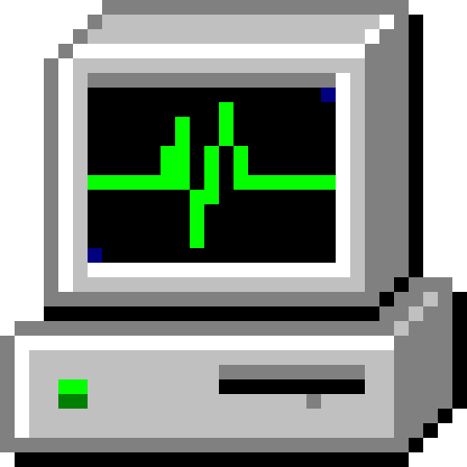

<div align="center"><a href="https://github.com/coignard/taskmgr">
  <picture>
    <source srcset="https://github.com/coignard/taskmgr/blob/main/assets/icon.png?raw=true">
    
  </picture>
</a>

Windows Task Manager as a to-do app

[](https://github.com/coignard/taskmgr/actions)
[](https://github.com/coignard/taskmgr/security/code-scanning)
[](https://codecov.io/github/coignard/taskmgr)
[](LICENSE)
[](https://ko-fi.com/coignard)

</div>

## Install

```bash
git clone https://github.com/coignard/taskmgr
cd taskmgr
cargo xtask bundle
cp -R "target/release/Task Manager.app" /Applications/
```

`cargo xtask bundle` prints where it put the app. With `--universal` it builds one that runs on both Apple silicon and Intel Macs, which needs both Rust targets:

```bash
rustup target add aarch64-apple-darwin x86_64-apple-darwin
cargo xtask bundle --universal
```

## Test

```bash
cargo test --workspace
```

Task Manager itself does not depend on macOS, so on other systems leave the shell out:

```bash
cargo test --workspace --exclude taskmgr-macos
```

## License


The [Task Manager](https://github.com/coignard/taskmgr) source code is © 2026 René Coignard and licensed under the [GNU General Public License v3.0 or later](LICENSE).

The look of Windows Task Manager, its icons, the Tahoma and MS Sans Serif typefaces and the Windows chord and ding sounds are © Microsoft and are not covered by this license.

All tests in this repository were written with Claude Code and are not covered by the GPL license.
